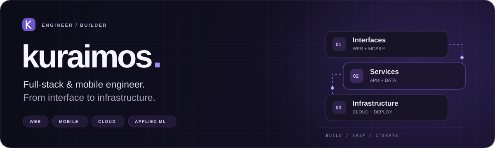

  <picture>
    <source media="(max-width: 600px)" srcset="assets/header-mobile.svg" />
    
  </picture>
    
  
  
  
    
  <a href="#selected-work">Selected work</a> &nbsp;&middot;&nbsp;
  <a href="#toolbox">Toolbox</a> &nbsp;&middot;&nbsp;
  <a href="#coding-activity">Coding activity</a>

 

## Selected work

Web products, applied AI, and tools built for real workflows. Explore more at [kuraimos.com](https://kuraimos.com).

<table>
  <tr>
    <td width="50%" valign="top">
      
      <h3>Full-Stack Photography</h3>
      
A photography portfolio with client quotation and invoice workflows.

      
<a href="https://christoophotography.com/">Open project &#8599;</a>

    </td>
    <td width="50%" valign="top">
      
      <h3>Media Downloader</h3>
      
Video and audio downloads from YouTube, Instagram, and TikTok.

      
<a href="https://mediadownloader.web.id/">Open project &#8599;</a>

    </td>
  </tr>
  <tr>
    <td width="50%" valign="top">
      
      <h3>Plat Detection API</h3>
      
AI-powered license plate detection with Samsat region lookup.

      
<a href="https://platdetection.kuraimos.com/">Open project &#8599;</a> &nbsp;&middot;&nbsp; <a href="https://github.com/kuraimoss/UAS-MachineLearning">Source code</a>

    </td>
    <td width="50%" valign="top">
      
      <h3>Cloud Storage</h3>
      
A personal platform to store, organize, and share files online.

      
<a href="https://cloudstorage.kuraimos.com/">Open project &#8599;</a> &nbsp;&middot;&nbsp; <a href="https://github.com/kuraimoss/cloud-storage">Source code</a>

    </td>
  </tr>
  <tr>
    <td width="50%" valign="top">
      
      <h3>Lucky Draw</h3>
      
An interactive random name picker for live events and digital draws.

      
<a href="https://luckydraw.kuraimos.com/">Open project &#8599;</a> &nbsp;&middot;&nbsp; <a href="https://github.com/kuraimoss/luckydraw">Source code</a>

    </td>
    <td width="50%" valign="top">
      
      <h3>kuraBOT</h3>
      
A WhatsApp assistant with AI tools, downloads, and group automation.

      
<a href="https://wa.me/6281943514940?text=Haloo%20kuraBOT">Open project &#8599;</a>

    </td>
  </tr>
</table>

## Toolbox

<b>Interfaces</b>  

<b>Services &amp; data</b>  

<b>Cloud &amp; infrastructure</b>  

<b>Applied machine learning</b>  

## Coding activity

  <picture>
    <source media="(prefers-color-scheme: dark)" srcset="https://github-readme-stats.vercel.app/api?username=kuraimoss&amp;show_icons=true&amp;hide_border=true&amp;rank_icon=github&amp;card_width=430&amp;bg_color=0d1117&amp;title_color=A78BFA&amp;icon_color=A78BFA&amp;text_color=c9d1d9&amp;ring_color=A78BFA&amp;cache_seconds=21600" />
    <source media="(prefers-color-scheme: light)" srcset="https://github-readme-stats.vercel.app/api?username=kuraimoss&amp;show_icons=true&amp;hide_border=true&amp;rank_icon=github&amp;card_width=430&amp;bg_color=ffffff&amp;title_color=6E56CF&amp;icon_color=6E56CF&amp;text_color=24292f&amp;ring_color=6E56CF&amp;cache_seconds=21600" />
    
  </picture>
  <picture>
    <source media="(prefers-color-scheme: dark)" srcset="https://streak-stats.vercel.app?user=kuraimoss&amp;hide_border=true&amp;card_width=430&amp;background=0D1117&amp;ring=A78BFA&amp;fire=A78BFA&amp;currStreakLabel=A78BFA&amp;sideLabels=C9D1D9&amp;dates=C9D1D9&amp;sideNums=C9D1D9&amp;currStreakNum=C9D1D9" />
    <source media="(prefers-color-scheme: light)" srcset="https://streak-stats.vercel.app?user=kuraimoss&amp;hide_border=true&amp;card_width=430&amp;background=FFFFFF&amp;ring=6E56CF&amp;fire=6E56CF&amp;currStreakLabel=6E56CF&amp;sideLabels=24292F&amp;dates=24292F&amp;sideNums=24292F&amp;currStreakNum=24292F" />
    
  </picture>

  
<b>Language mix &amp; contribution calendar</b>

   
  

  <picture>
    <source media="(prefers-color-scheme: dark)" srcset="https://github-readme-stats.vercel.app/api/top-langs/?username=kuraimoss&amp;layout=compact&amp;hide_border=true&amp;card_width=430&amp;bg_color=0d1117&amp;title_color=A78BFA&amp;text_color=c9d1d9&amp;cache_seconds=21600" />
    <source media="(prefers-color-scheme: light)" srcset="https://github-readme-stats.vercel.app/api/top-langs/?username=kuraimoss&amp;layout=compact&amp;hide_border=true&amp;card_width=430&amp;bg_color=ffffff&amp;title_color=6E56CF&amp;text_color=24292f&amp;cache_seconds=21600" />
    
  </picture>
      
    
  

 

---

  <h3>Let's build something useful.</h3>
  
Thoughtful interfaces. Practical systems. Products that work.

  <a href="https://kuraimos.com">Explore the portfolio &#8599;</a> &nbsp;&middot;&nbsp;
  <a href="https://www.linkedin.com/in/saintripentumanggor">Connect on LinkedIn</a>

